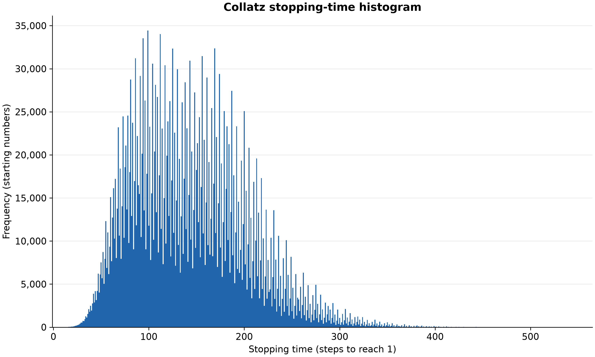
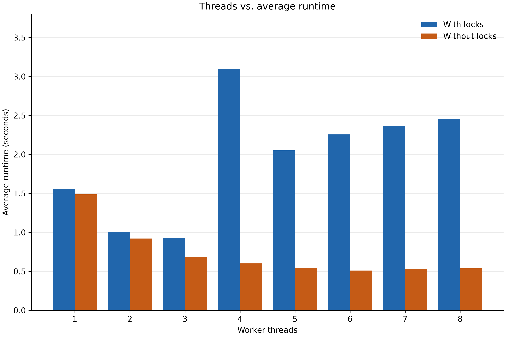
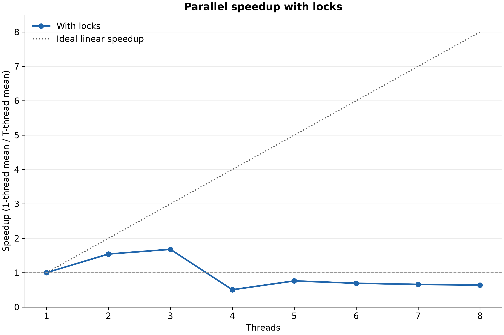
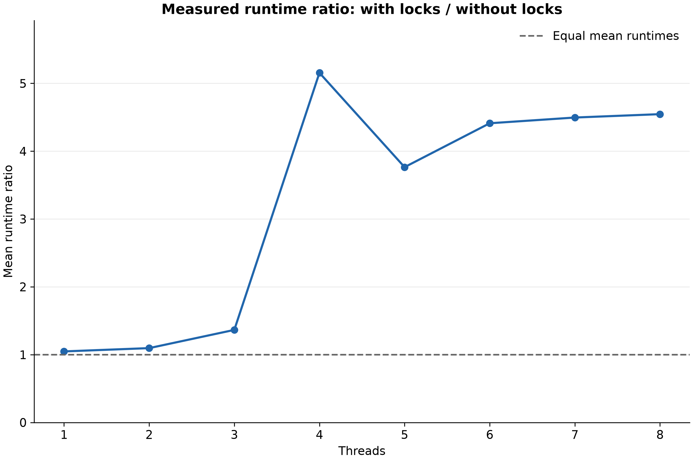
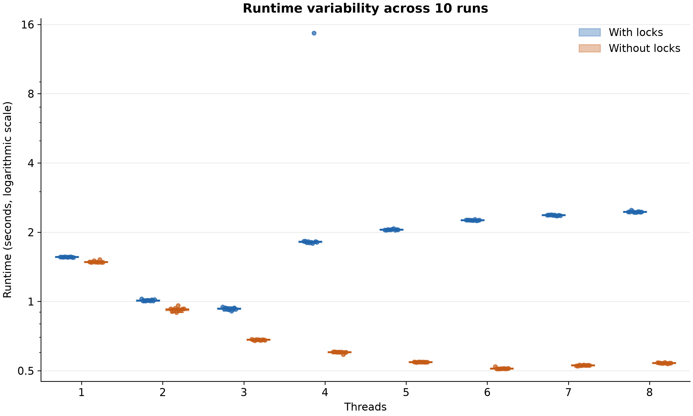

# Project 2 Midpoint Report

Multi-Threaded Collatz Stopping Time Generator

Lance Penaflor | COP4634 Systems & Networks I | October 16, 2026

**Draft report.**

## Experiment

### Experiment description

This project measures how the number of worker threads and the use of mutex locks affect the time required to compute a Collatz stopping-time histogram. For every starting number from 1 through N, the program repeatedly divides an even value by two or replaces an odd value with 3n + 1, counting the steps until the value becomes 1. The histogram contains buckets 0 through 1000. The number 1 contributes one occurrence to bucket 0.

The program creates T C++ worker threads. A global COUNTER identifies the next starting number. A worker locks the shared mutex, checks the limit, claims a number, and releases the mutex before computing its sequence. It then locks the same mutex to increment the global histogram. These two critical sections prevent duplicate claims and lost histogram updates. The optional -nolock argument skips both locks. The main thread joins every worker before recording the ending time and printing the results.

### Machine and measurement method

The measurements were collected on October 12, 2026, from 11:03:45 to 11:07:28 CDT on an Apple M1 Pro with 8 physical cores, 8 logical CPUs, and 16 GiB RAM. The recorded operating-system version is macOS 27.0.1. The compiler was Apple Clang 21.0.0 (clang-2100.3.34.2). The build used C++17, -g, -Wall, and -Wextra, with no optimization flag.

Pilot tests used N = 100,000, 1,000,000, and 3,000,000. The experiment selected N = 3,000,000 to produce measurable runtimes. For each thread count from 1 through 8, both locked and unlocked modes were run ten times, giving 160 measured executions. Executions were sequential. Each of ten rounds shuffled all sixteen configurations using random seed 4634 to distribute background-load changes across configurations. Pilot runs and a separate reference run were excluded from the averages.

CLOCK_REALTIME measured the interval from immediately before thread creation through completion of all joins. The subtraction borrows one second if the nanosecond difference is negative. Histogram printing is outside the measured interval. Timing goes to stderr as N,T,seconds.nanoseconds, with nine fractional digits; histogram rows go to stdout. Clock adjustments and background activity can affect the measurements, and nanosecond formatting does not establish nanosecond accuracy.

Each measured histogram was compared bucket by bucket with a separate locked single-thread reference. All 80 locked runs and all 10 unlocked single-thread runs matched. All 70 unlocked multithreaded runs differed. The timed worker algorithm was retained during final polish; the report describes the archived October 12 measurements rather than new timing trials.

---

## Results

### Collatz stopping-time histogram

Figure 1. Frequency of stopping times for starting numbers 1 through 3,000,000, from the locked single-thread reference run. The plot shows the occupied range; all buckets 560 through 1000 are zero and remain in the spreadsheet data.

The histogram contains exactly 3,000,000 observations. Bucket 0 contains one observation, corresponding to the starting number 1. The most frequent stopping time is 99 steps, with 34,427 starting numbers. The mean stopping time is approximately 142.78 steps, and the largest observed stopping time is 559 steps.

The distribution is irregular and has a long right tail: starting values in the same input range can require very different amounts of work. Claiming one number at a time allows workers to keep taking work as they finish rather than assigning every worker a fixed consecutive block. This distributes varying sequence lengths dynamically, but each claim also requires synchronization in locked mode.

The reference histogram, all 1001 bucket frequencies, and the runtime data are included in the Excel workbook. Matching the total alone would not prove correctness because errors could cancel across buckets; the experiment therefore checked every bucket.

---

### Runtime results

Figure 2. Arithmetic mean of ten executions per configuration, N = 3,000,000. The four-thread locked mean includes the unusually slow run discussed below. Unlocked multithreaded results produced incorrect histograms.

| Threads | With locks (s) | Without locks (s) | Locked speedup |
| --- | --- | --- | --- |
| 1 | 1.559351 | 1.487961 | 1.000x |
| 2 | 1.011490 | 0.922480 | 1.542x |
| 3 | 0.929531 | 0.680992 | 1.678x |
| 4 | 3.099322 | 0.601193 | 0.503x |
| 5 | 2.052243 | 0.545144 | 0.760x |
| 6 | 2.256135 | 0.511411 | 0.691x |
| 7 | 2.370218 | 0.527183 | 0.658x |
| 8 | 2.453416 | 0.539706 | 0.636x |

The fastest correct mean is 0.929531 seconds with three threads. The lowest unlocked mean is 0.511411 seconds with six threads, but that configuration did not compute the correct histogram. Both curves change with thread count, showing that adding threads affects runtime even when it does not improve performance.

---

## Discussion

### Performance improvements through parallel execution

Figure 3. Locked speedup S(T) = locked mean at one thread / locked mean at T threads. The dotted line is ideal linear speedup; values below 1 indicate a slowdown relative to one thread.

Two threads achieved a speedup of 1.542x, reducing runtime by approximately 35.1%. Three threads achieved 1.678x, reducing runtime by approximately 40.4%. Parallel efficiency, S(T)/T, was approximately 77.1% at two threads and 55.9% at three threads. These results show useful parallelism, with diminishing benefit as thread count rises.

At five through eight threads, the locked means were slower than the one-thread baseline. Eight threads took 2.453416 seconds, approximately 57.3% longer than one thread. Having eight logical CPUs therefore did not guarantee that eight workers were best for this implementation.

Each number requires two acquisitions of the same shared mutex, or about six million acquisitions for the measured range, plus termination checks. Although sequence calculations occur outside the critical sections, workers serialize when claiming work and updating buckets. Contention, synchronization, scheduling, and movement of shared data between cores plausibly explain the limited scaling. These mechanisms were not measured individually, so the data supports this explanation without identifying their separate costs.

A possible future comparison would claim batches of numbers and accumulate private histograms before merging. That would reduce synchronization frequency while preserving correctness, but it would be a different implementation and would need a new experiment.

---

### Impact of locks on performance and correctness

Figure 4. With-locks mean divided by without-locks mean at the same thread count. This ratio compares observed executions; it does not isolate mutex cost when the unlocked program is incorrect.

At one thread, both modes produce the same histogram. Locks increased the mean from 1.487961 to 1.559351 seconds, a difference of 0.071390 seconds or approximately 4.8%. Because there is no worker contention and both runs do equivalent work, this is the clearest measured indication of uncontended synchronization overhead, although other timing variation remains possible.

At three threads, the locked mean was 1.365 times the unlocked mean. At eight threads, it was 4.546 times the unlocked mean. The four-thread ratio was 5.155, influenced heavily by its slow locked observation. These differences include changes in work caused by races, so they cannot be interpreted as pure lock overhead or valid unlocked speedups.

Without locks, two workers can read the same COUNTER value and claim duplicate work. Concurrent histogram increments can also overwrite each other. The unlocked multithreaded totals ranged from 3,128,738 to 4,142,406 instead of 3,000,000. All 70 such runs differed from the reference. C++ data races cause undefined behavior, so these particular errors and runtimes are observations, not guaranteed outcomes. Locks were necessary to obtain correct results consistently.

---

### Variability and limitations

Figure 5. Runtime distributions on a logarithmic vertical axis. Every measurement is shown, including the unusually slow four-thread locked observation.

One locked four-thread run took 14.682816 seconds. The other nine ranged from 1.788375 to 1.832101 seconds. The required ten-run mean is 3.099322 seconds, with sample standard deviation 4.070050 seconds. The median is 1.817070 seconds. For sensitivity only, excluding the slowest run would give a mean of 1.812267 seconds; the reported average retains all ten measurements. Even that illustrative value is slower than the one-thread locked mean. The cause of the slow observation was not measured and cannot be assigned to a particular background task or scheduling event.

Results apply to one input size, one machine, one build configuration, and ten runs per configuration. No optimization flag was used. Different hardware, compiler options, workloads, or synchronization designs may change the preferred thread count. The fixed histogram and 64-bit sequence arithmetic also limit the input domain; this experiment validates N = 3,000,000 rather than arbitrary Collatz inputs.

## Conclusions

The program computed correct histograms with mutex protection across all measured thread counts. Parallel execution helped up to three threads, where the correct computation achieved approximately 1.68x speedup. The M1 Pro exposes eight logical CPUs for parallel work, but this workload scaled best with three workers; the shared mutex limits how effectively additional cores can be used. Removing locks reduced observed runtimes but introduced incorrect output in every multithreaded trial. The experiment demonstrates that correctness must be checked alongside runtime, and that additional threads are useful only when their parallel work outweighs synchronization costs.

### Supporting materials

The workbook cop4634 proj2.xlsx contains runtimes, histogram data, raw measurements, machine details, and the required charts. Source measurements are in experiments/raw_times.txt, average_times.txt, histogram.txt, timing_statistics.txt, and machine_and_method.txt. The assignment requirements are in Project 2 MT Collatz.pdf. This draft follows the Experiment, Results, Discussion, and Conclusions structure in Project 2 Midpoint Report Template.docx, including its runtime bar chart requirement.
